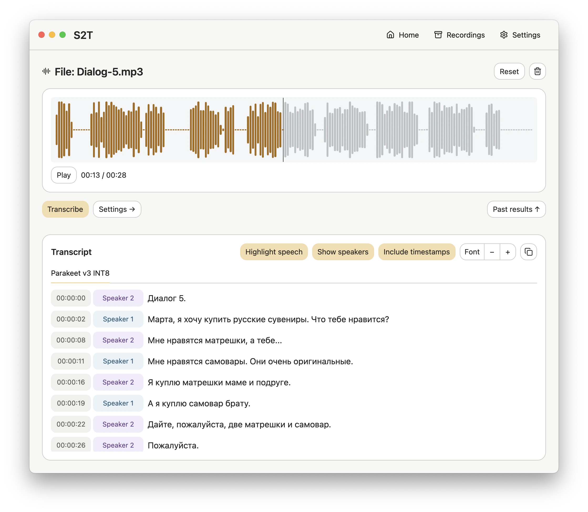

# S2T (Speech-to-text)

S2T записывает звук и превращает аудио в текст на вашем компьютере. Приложение бесплатное, с открытым исходным кодом. После скачивания моделей распознавание работает офлайн.

[Скачать S2T на GitHub Releases](https://github.com/ufocoder/speech-to-text/releases/latest)

| Платформа | Окончание имени ZIP |
| --- | --- |
| macOS с Apple Silicon | `macos-arm64.zip` |
| macOS с Intel | `macos-x86_64.zip` |
| Windows 64-бит | `windows-x64.zip` |

## Первый запуск

1. Скачайте ZIP для своего компьютера, распакуйте его и запустите приложение.
2. В «Настройках» скачайте модель распознавания. По умолчанию выбрана Parakeet v3 INT8. Для разделения речи по говорящим скачайте модель из отдельной таблицы в настройках.
3. Нажмите «Сделать запись» или «Открыть аудиофайл». Поддерживаются WAV, MP3, FLAC и Ogg Vorbis. Для записи на macOS разрешите приложению доступ к микрофону.
4. Нажмите «Распознать». Выбор моделей для текущего файла доступен под плеером через «Настройки →». В расшифровке можно включить тайминги и отметки говорящих, изменить размер текста и скопировать результат.

## Аудиозаписи и результаты

- Плеер показывает звуковую волну. Нажмите на неё, чтобы перейти к нужному месту записи.
- «Аудиозаписи» показывает файлы из выбранной папки, время записи и модели, которыми получены сохранённые расшифровки.
- Для одного файла можно хранить результаты нескольких моделей. При обычном открытии файла сохранённый текст доступен через «Прошлые результаты →».
- В «Настройках» можно сменить микрофон, папку записей и язык интерфейса. Доступны русский и английский.

По умолчанию приложение сохраняет записи в подпапку `recordings`, а модели в `.model-cache/hub`. В пакете macOS эти подпапки находятся в `~/Library/Application Support/Speech to Text/`, в Windows — в `%LOCALAPPDATA%\Speech to Text\`.

## Разработка

[Сборка, тестирование, локальный сайт и релизы](docs/development.md)

## Лицензия

Код проекта распространяется по [лицензии MIT](LICENSE).
